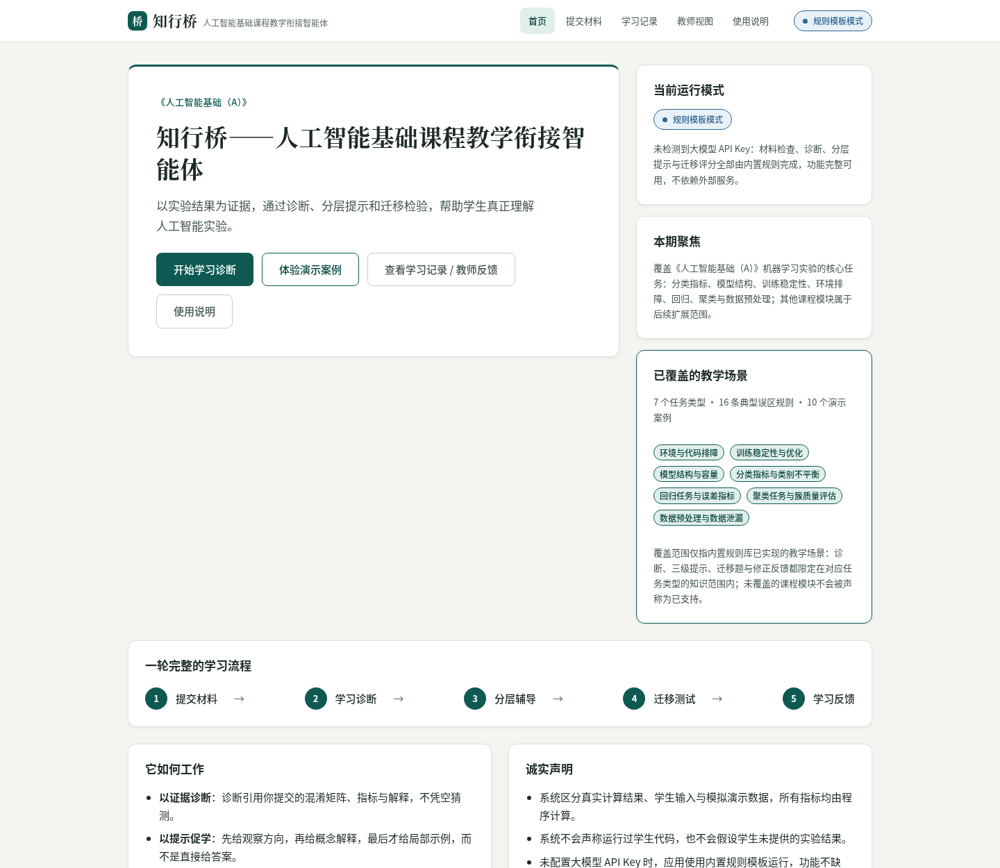
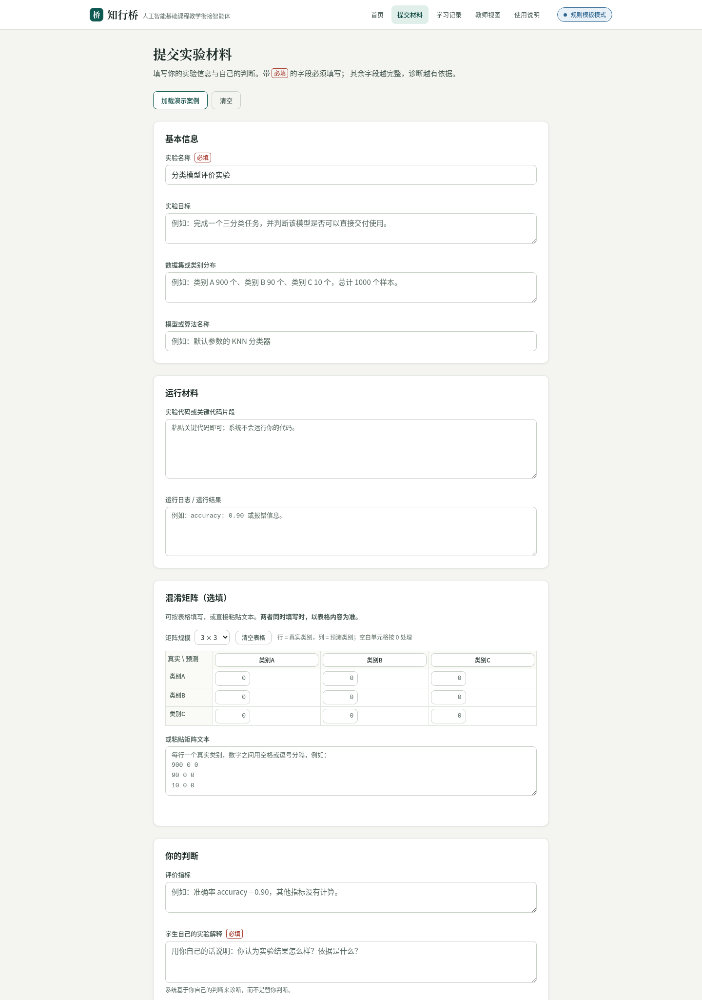
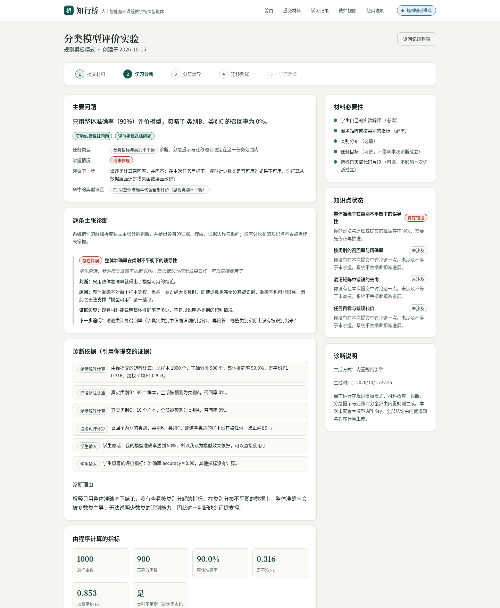
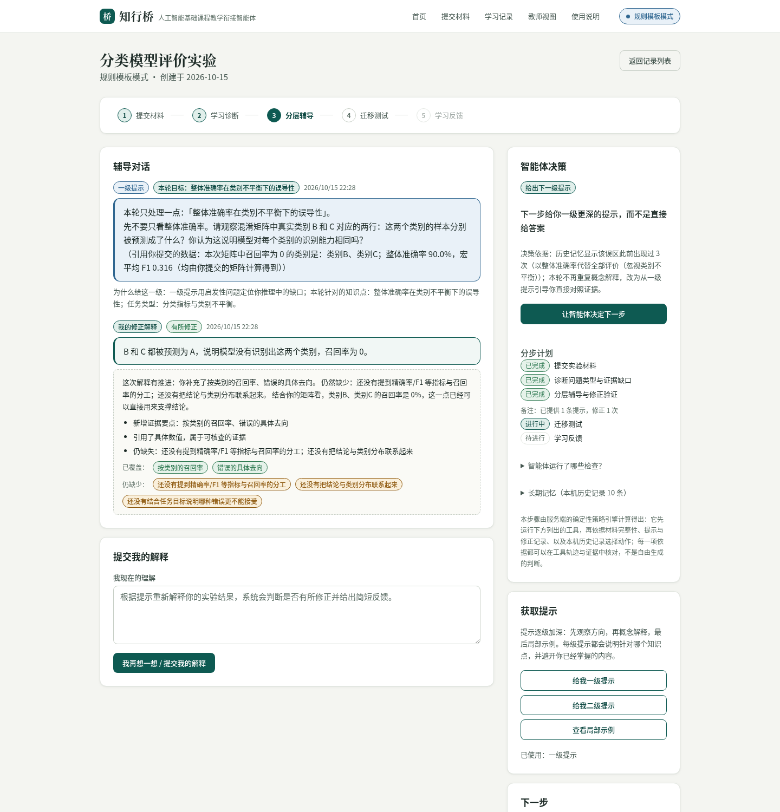
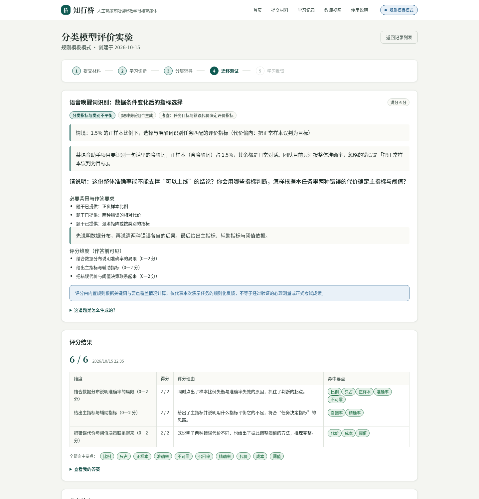
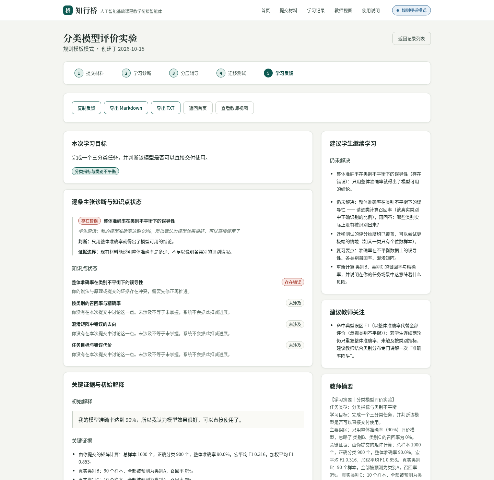
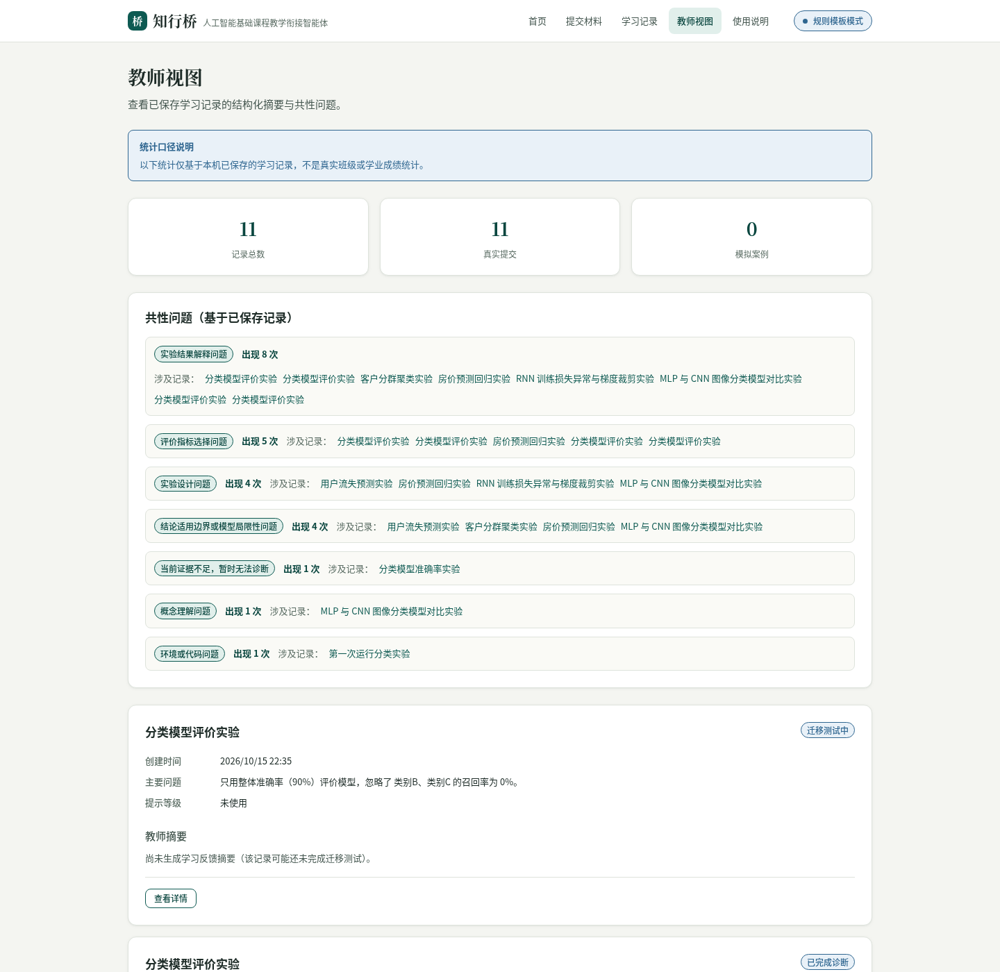
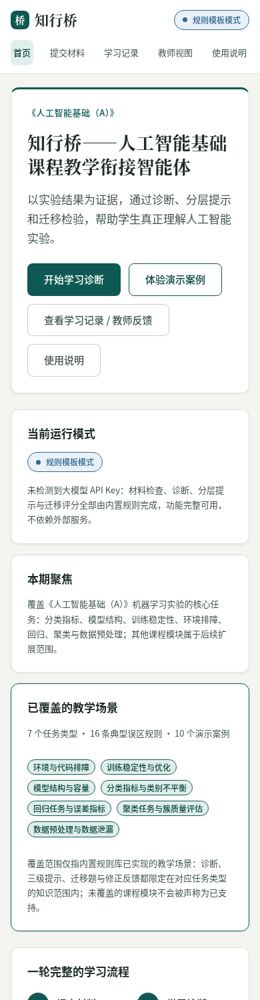

# 知行桥——人工智能基础课程教学衔接智能体

面向本科低年级《人工智能基础（A）》实验教学的智能体 Web 应用。它围绕学生提交的实验证据做诊断，用三级提示引导学生自己推理，再用新情境迁移题检验理解，最后生成教师可用的结构化学习反馈。

**技术栈**：Go（Gin + GORM + SQLite）后端 + Vue 3（Vite + TypeScript）前端。

> 已覆盖《人工智能基础（A）》机器学习实验的核心任务：分类指标、模型结构、训练稳定性、环境排障、回归、聚类与数据预处理；其他课程模块属于后续扩展范围（当前 7 个任务类型 / 16 条典型误区规则 / 10 个演示案例，首页与 `GET /api/meta` 会实时展示同一份覆盖范围）。
> 内置演示案例中的数据均为**人工构造的教学演示数据**，不是真实训练实验结果，也不代表任何真实学生的学习成效。

## 界面预览

以下截图均取自本项目**实际运行界面**（规则模式 + 预置模拟案例数据），未做设计稿替换。

| 首页：产品定位与已覆盖教学场景 | 提交实验材料：10 个字段 + 混淆矩阵实时校验 |
|---|---|
|  |  |
| **诊断结果**：问题类型、引用的证据、逐条主张与掌握情况 | **分层辅导**：三级提示 + 智能体决策、工具轨迹与跨会话记忆 |
|  |  |
| **迁移测试**：作答前即可见评分维度，作答后才给参考答案 | **学习反馈**：结构化摘要与一键导出 Markdown / TXT |
|  |  |
| **教师视图**：共性问题与记录摘要（仅本机记录，不作班级统计） | **窄屏适配**：手机宽度下的首页与全流程 |
|  |  |

## 设计要点（技术实现摘要）

几个能当场核对的工程决策，而不是宣传语：

1. **任务类型先行**：先判定当前实验属于哪一类（分类指标 / 模型结构 / 训练稳定性 / 环境排障 / 回归 / 聚类 / 数据预处理），诊断、三级提示、迁移题与修正反馈都必须落在该类型的知识范围内。跨类型串味有测试拦：训练稳定性任务不得命中混淆矩阵类规则。
2. **主张级诊断而非整段打分**：学生解释被拆成独立主张，每条给判断、原因、**证据边界**与下一步追问；“未涉及”不会被当成“未掌握”。
3. **迁移题可重建、可去重**：题目由题目族 × 变体 × 参数组合生成，编号可直接重建（题库不落入学生记录）；生成后与示例情境、历史题目做字符二元组相似度去重，并标注题目来源、选题依据与重复检查结果。
4. **评分不自相矛盾**：有一条不变量测试——**每道迁移题的参考答案在它自己的评分维度下必须满分**，逐题族 × 变体 × 参数组合核对，避免“写出标准答案却被扣分”。
5. **智能体是确定性策略，不冒充自由推理**：每一步先跑工具（证据完备性 / 指标计算 / 提示与修正进度 / 本机历史查询）再选动作，输出分步计划与工具轨迹；证据不足时**拒绝**给出具体计算示例。界面明写“这不是自由生成的判断”。
6. **大模型只负责说人话**：指标、类别与评分全部由程序计算；模型输出要过结构校验和“数值不得凭空出现”校验（两位数及以上必须能在学生材料或程序结果里找到），失败就整段回退并写明**是哪个数值**。
7. **质量门一条命令**：`make check` = 后端 vet/test/build + 前端单元测试/类型检查/打包；CI 跑同一套。所有演示数据与结论都能用这套命令复现。

## 1. 环境要求

| 组件 | 版本 | 说明 |
|---|---|---|
| Go | 1.25.12+ | 后端，使用纯 Go 的 SQLite 驱动，无需 cgo |
| Node.js | 18+（本项目在 24 上验证） | 前端构建 |
| pnpm | 8+ | 前端包管理（也可用 npm） |
| 数据库 | 无需额外安装 | 默认使用 SQLite 文件 `server/data/knowbr.db` |

大模型 API Key **不是必需项**：未配置时应用以「规则模板模式」完整运行。

## 2. 安装与启动

### Docker Compose 启动

安装 Docker Engine / Docker Desktop 和 Docker Compose v2 后，在项目根目录运行：

```bash
docker compose up -d --build --wait
```

打开 <http://127.0.0.1:8080>。镜像会自动构建 Vue 前端与 Go 后端，无需在宿主机安装 Go、Node.js 或 pnpm。

可选：复制 `.env.example` 为 `.env` 后调整 `ZXQ_PORT`（宿主机端口）和 `ZXQ_LLM_*`。Compose 会自动读取根目录 `.env`；容器内部端口、数据库和静态资源路径固定，不使用 `.env` 中的 `ZXQ_DB_PATH`、`ZXQ_WEB_DIST`。例如已有服务占用 8080 时：

```bash
ZXQ_PORT=8081 docker compose up -d --build --wait
```

如果构建时无法访问默认 Go 依赖源，可在 `.env` 设置 `GOPROXY=https://goproxy.cn,direct`，或运行：

```bash
GOPROXY=https://goproxy.cn,direct docker compose up -d --build --wait
```

SQLite 保存在 `knowbr-data` 命名卷中，容器重建和 `docker compose down` 不会删除学习记录。以下命令用于查看状态、日志和停止服务：

```bash
docker compose ps
docker compose logs -f knowbr
docker compose down
```

`docker compose down -v` 会删除命名卷及全部学习记录，只在需要清空容器数据时使用。源码更新后再次执行 `docker compose up -d --build --wait` 即可更新。

### 2.1 启动后端（端口 8080）

```bash
cd server
go mod tidy          # 首次运行，下载依赖
go run .             # 默认 http://127.0.0.1:8080
```

可选环境变量见根目录 [`.env.example`](.env.example)：`ZXQ_PORT`、`ZXQ_DB_PATH`、`ZXQ_WEB_DIST`、`ZXQ_LLM_*`。
后端从进程环境读取配置，不会自动加载 `.env` 文件；请使用 `export` 设置变量后启动。

### 2.2 启动前端（开发模式，端口 5173）

```bash
cd web
pnpm install
pnpm dev             # Vite 开发服务器，/api 自动代理到 127.0.0.1:8080
```

打开 <http://127.0.0.1:5173>。

### 2.3 生产模式（单端口演示，推荐录屏使用）

```bash
cd web && pnpm build          # 产出 web/dist
cd ../server && go run .      # 后端会自动托管 ../web/dist，访问 http://127.0.0.1:8080
```

后端在检测到 `web/dist/index.html` 存在时托管前端静态资源，并支持单页应用回退。

## 3. 是否需要 API Key

- **不配置**：`GET /api/meta` 返回 `mode.code = "rule"`，界面显示「规则模板模式」。材料检查、诊断、三级提示、迁移评分、学习摘要全部由内置规则完成，功能不缺失。
- **配置**：在服务端设置 `ZXQ_LLM_API_KEY`（可选 `ZXQ_LLM_BASE_URL`、`ZXQ_LLM_MODEL`、`ZXQ_LLM_TIMEOUT_SECONDS`、`ZXQ_LLM_EXTRA_HEADERS`、`ZXQ_LLM_USER_AGENT`）。密钥只保存在服务端，前端永不可见；只有诊断/摘要中**自然语言表达**部分会交给大模型组织，指标数值、诊断类别与评分仍由程序计算。模型输出会经过结构校验与「数值不得凭空出现」校验，任一校验失败自动回退规则模式，并记录回退原因，学生已填内容不会丢失。

### 3.1 接入真实大模型（已验证示例：OpenCode Go 订阅 + DeepSeek V4）

任何 OpenAI 兼容的 Chat Completions 服务都可以直接接入。下面这组配置已在 `deepseek-v4.1-flash` 上实际跑通一次完整诊断与摘要（见下方“已验证”说明）：

```bash
cd server
export ZXQ_LLM_API_KEY="你的服务端密钥"          # 仅服务端可见，不要写入前端或仓库
export ZXQ_LLM_BASE_URL="https://opencode.ai/zen/go/v1"
export ZXQ_LLM_MODEL="deepseek-v4.1-flash"
export ZXQ_LLM_USER_AGENT="zhixingqiao-knowbr/1.0"
# OpenCode Go 要求客户端上报稳定的会话标识，{{session}} 会被替换为本次学习会话编号
export ZXQ_LLM_EXTRA_HEADERS="x-opencode-session={{session}}"
go run .
```

- `ZXQ_LLM_EXTRA_HEADERS` 为可选的附加请求头，格式为 `名称=取值`，多项用 `;`、`,` 或换行分隔；取值中的 `{{session}}` 会替换为当前学习会话编号，便于服务端做路由与提示缓存。条目不合法时自动跳过，不会阻断启动。
- `ZXQ_LLM_USER_AGENT` 用于声明调用方身份（默认 `zhixingqiao-knowbr/1.0`），便于服务端区分流量。
- **数值审查规则**：模型输出里只允许出现学生自己提交过的数字（标题、目标、数据描述、代码、日志、指标、解释，以及规则引擎结论）与程序计算的指标；单个数字（如“第 3 轮”“2 类”）视为序数放行，两位及以上的未提供数值会被拦下。回退原因会写明具体是哪个数值，例如“大模型输出引入了未提供的数值「97」”，便于当场核对而不是只看到一句“调用失败”。
- 换成其它服务商时，只需改 `ZXQ_LLM_BASE_URL` / `ZXQ_LLM_MODEL`，并删掉 `ZXQ_LLM_EXTRA_HEADERS` 即可。
- **已验证**：本项目在 OpenCode Go 订阅的 `deepseek-v4.1-flash` 上完成过一次真实联通验证（诊断与教师摘要各调用一次，进入 `llm` 模式、`llmUsed=true`、无回退）。该验证是单次人工联调，不代表持续线上可靠性；未配置密钥时应用仍然完整运行在规则模式。

## 4. 如何加载预置案例并跑通一轮流程

1. 首页点击「体验演示案例」，或进入「提交实验材料」后点击「加载演示案例」选择其一：
   - **案例一**：类别极不平衡的三分类任务（核心演示，准确率 90% 但 B、C 两类召回率为 0）；
   - **案例二**：只提交准确率（演示「证据不足时应追问」）；
   - **案例三**：误读混淆矩阵（陈述与证据矛盾）；
   - **案例四**：代码跑通就认为学会；
   - **案例五**：环境报错（直接给排障步骤）；
   - **案例六**：MLP 与 CNN 图像分类对比（模型结构类任务：同一段话里的三个不同推理问题被分别诊断）；
   - **案例七**：RNN 训练损失异常与梯度裁剪（训练稳定性任务：引用日志数值、区分事实与推断，不转向分类指标）；
   - **案例八**：房价预测回归任务只看训练集误差（回归任务：把 MAE 换算成目标变量的量级、留出验证集、与基线对照）；
   - **案例九**：K-means 分群只看轮廓系数（聚类任务：内部指标的局限、簇数选择、标准化与稳定性检查）；
   - **案例十**：先标准化后划分的数据泄漏（预处理任务：参数应在划分后、只在训练集上估计）。
2. 点击「开始诊断」→ 查看诊断结果（问题类型、证据、诊断理由、掌握情况、建议下一步）。
3. 进入「分层辅导」：依次使用「给我一级提示」「给我二级提示」「查看局部示例」，在输入框写下自己的解释并提交，观察「是否修正」的反馈；连续两轮无进展会出现「建议教师介入」。
4. 进入「迁移测试」：先独立作答并提交，**提交后**才显示评分依据与参考答案。
5. 点击「完成本次学习」→ 学习反馈页，可复制反馈、导出 Markdown/TXT；教师视图可见记录摘要与共性问题。

混淆矩阵可以粘贴文本（空格/制表符/逗号分隔，可带类别名称首列）或按表格填写，界面会实时调用 `/api/metrics/compute` 校验，非法输入会给出中文定位提示且**不清空已填内容**。

## 5. 已实现功能

- **首页与导航**：产品定位、五步流程、四个入口、运行模式徽标、本期聚焦范围。
- **实验材料提交**：需求文档要求的 10 个字段（含混淆矩阵粘贴/表格双输入）+ 加载演示案例 + 清空 + 开始诊断。
- **材料完整性检查**：缺学生解释直接拦截；只有准确率时判定「证据不足」并追问类别分布、任务目标与逐类指标，不武断评价模型好坏。
- **学习问题诊断**：七类问题多选，输出主要问题、证据（含来源标注：学生输入 / 混淆矩阵计算）、诊断理由、掌握情况、建议下一步；识别「陈述与证据矛盾」。
- **分层辅导**：三级提示（观察方向 → 概念解释 → 局部计算示例），提示引用本次矩阵的真实数值；环境类问题直接给排障步骤而非苏格拉底式提问；学生修正反馈、推进状态与教师介入判断。
- **迁移测试**：题目由规则模板按当前实验的任务类型与命中的问题类型组合生成（情境与数据条件由模板参数决定），生成后与演示案例、提示示例及本机历史题目做相似度去重，并标注题目来源、选题依据与重复检查结果；三维度 0—2 分共 6 分，逐维给出理由；参考答案在学生作答前不返回（接口层面拦截）。
- **任务类型约束**：每次诊断先判定当前实验属于分类指标 / 模型结构 / 训练稳定性 / 环境排障 / 回归任务 / 聚类任务 / 数据预处理任务中的哪一类，诊断、三级提示、迁移题与修正反馈都限定在该类型的知识范围与必需证据内：训练稳定性任务不会要求混淆矩阵或分类指标，结构比较任务不会要求逐类召回率，回归任务只看误差量纲、泛化估计与基线对照，聚类任务只看内部指标含义、簇数选择、标准化与稳定性，预处理任务只看预处理与划分的顺序、特征可得性与评估流程一致性。
- **学习摘要与教师反馈**：结构化摘要 + 一键复制 + 导出 Markdown/TXT；教师视图展示记录摘要、提示轨迹、迁移表现与共性问题（统计仅来自本机记录）。
- **学习记录**：服务端 SQLite 持久化，重启后仍在；支持查看详情、删除单条、清空全部；不收集姓名、学号等个人信息。
- **指标计算**：总样本数、正确数、准确率、逐类召回率/精确率/F1、宏平均与加权平均 F1、类别占比与不平衡比，全部由程序计算并有单元测试手工核对。
- **规则模式与模型模式**：`rule` / `demo` / `llm` 模式标识与诚实说明（是否真的调用过大模型）。
- **智能体决策**：每一步由服务端策略引擎先运行工具（证据完备性检查、指标计算、提示与修正进度检查、本机历史查询），再决定动作——补齐证据 / 给出建议等级的提示 / 等待修正 / 推进迁移 / 建议教师介入——并输出可核对的分步计划与工具轨迹；证据不足时**拒绝**直接给出具体计算示例；跨会话记忆会识别本机历史中反复出现的误区，并据此从最基础的观察方向重新引导（无账号体系，记忆按“本机”归并，界面会如实标注局限）。

## 6. 暂未实现 / 已知限制

- 未实现账号体系、真实班级管理与教务系统对接；教师视图只展示本机记录与共性问题计数，**不生成班级通过率、诊断准确率等未经测量的统计**。
- 不执行用户提交的 Python 代码，不解析 PDF/Word/图片；输入以文本为主。
- 大模型接入为可选增强，未配置时完全走规则引擎；已在 OpenCode Go 订阅的 DeepSeek V4.1 Flash 上完成过一次真实联通验证（诊断与摘要各一次调用），但仅此一次人工联调，未做长期线上稳定性与多服务商适配验证。接口、超时、请求头与会话标识、结构校验、编造数值拒绝与回退路径均有自动化测试覆盖（含成功路径）。
- 迁移题评分为关键词规则打分，只反映要点覆盖情况，不等于人工评分或正式考试成绩。
- 迁移题属于规则模板组合生成（未调用大模型）：情境与数据条件来自模板参数，不是开放式自由生成；界面与接口都会标注题目来源。
- 混淆矩阵必须为方阵且非负；零分母按约定处理（见下）。
- 规则库目前覆盖「机器学习分类实验」及其相邻任务（模型结构、训练稳定性、环境排障、回归任务、聚类任务、数据预处理任务）共 E0—E16 十六条典型误区规则（完整列表见 `GET /api/meta` 的 `archetypes`）；其他课程模块未覆盖。

### 指标零分母约定

- 某类别**没有任何预测样本**时，其精确率分母为零：按本应用约定记 `precision = 0` 并标记 `precisionUndefined = true`，界面同时展示说明文字。
- 某类别**在数据中不存在**（样本数为 0）时，其召回率分母为零：记 `recall = 0` 并标记 `recallUndefined = true`。
- 宏平均 F1 对每个类别等权（未定义项按 0 计入），加权平均 F1 按各类别真实样本数加权。这些约定会随计算结果一并返回在 `metrics.notes` 中并在界面原样展示。

## 7. 测试

一条命令跑完全部质量门（后端静态检查 + 全部测试 + 构建；前端单元测试 + 类型检查 + 打包）：

```bash
make check
```

也可以分开跑：

```bash
cd server && go vet ./... && go test ./... && go build ./...
cd web && pnpm test             # 前端单元测试（vitest）
cd web && pnpm build            # vue-tsc --noEmit + vite build
```

仓库自带 `.github/workflows/ci.yml`，推送到 GitHub 后会自动跑与 `make check` 完全相同的两步（后端 / 前端）。

### 7.1 界面冒烟测试（可选，需要真实浏览器）

单元测试与接口测试都不会点击界面。下面这条命令用真实浏览器（Bun 内置的 `Bun.WebView`）把「提交材料 → 诊断 → 分层辅导（含让智能体自主决定下一步）→ 修正解释 → 迁移测试（含作答前不泄露参考答案）→ 学习反馈 → 学习记录删除」实际点一遍，并断言关键界面状态与页面控制台无报错：

```bash
cd server && go run .              # 另一个终端先启动服务
make smoke                         # 默认 http://127.0.0.1:8080
```

它需要 **Bun ≥ 1.4**（内置 WebView）与本机已安装 Chrome/Chromium；Bun 找不到浏览器时用 `BUN_CHROME_PATH` 指定可执行文件。该脚本会新建一条演示记录并把它删除，请对着演示实例运行。当前共 34 项断言，已在 Chrome 上全部通过。

前端单元测试覆盖：时间/百分比/得分文本的边界（空值、非法值、未评分 -1、非有限值）、修正进度与主张六种状态的配色映射、会话状态到步骤序号的映射、提示等级文案、错误对象到中文提示的兜底、以及复制功能三个分支（clipboard 可用 / 退回隐藏 textarea / 两者都失败）。

后端测试覆盖：混淆矩阵指标手工核对（核心演示案例 900/90/10 得到准确率 0.9、B/C 召回率 0、宏平均 F1 = 1/3×F1_A）、非法矩阵（负数/行列不一致/非数字/全 0）、典型误区命中与误报边界、任务类型判定与跨任务规则隔离（训练稳定性任务不命中分类指标类规则）、逐条主张拆分与六种状态、三级提示与重复请求、修正进度按任务类型判定与教师介入、迁移评分确定性、迁移题参考答案在自身评分维度下必须满分（题目族 × 变体 × 参数组合逐一核对）、参考答案不提前泄露、迁移题按任务类型生成且与示例情境去重、完整演示闭环（诊断→提示→修正→迁移→反馈→教师视图）、Lab5-02 式 RNN 案例的主题一致性回归、回归任务场景（只看训练集误差 / 误用 R² 的诊断与提示不越界）、聚类任务场景（只看轮廓系数数值 / 用有监督指标评价聚类）、数据泄漏场景（先全量预处理再划分）、异常输入保留内容、记录持久化与删除、大模型可用时的接口层成功路径（进入 llm 模式、摘要采用模型文本、每次请求携带学习会话编号）与编造数值回退。

## 8. 目录结构

```text
knowbr/
├── README.md                  # 本文件
├── .env.example               # 环境变量示例（不含真实密钥）
├── docs/
│   ├── API_CONTRACT.md        # 前后端接口契约（冻结版）
│   ├── DEMO_SCRIPT.md         # 5—7 分钟演示脚本
│   └── screenshots/           # README 使用的实际运行界面截图
├── Makefile                   # make check：一键质量门；make smoke：真实浏览器界面冒烟
├── scripts/
│   └── ui-smoke.mjs           # 界面冒烟测试（Bun.WebView 驱动真实 Chrome）
├── server/                    # Go + Gin + GORM
│   ├── main.go
│   └── internal/
│       ├── api/               # 路由、处理器、DTO、端到端测试
│       ├── content/           # 演示案例、任务类型、典型误区规则库、迁移题题库与生成模板
│       ├── models/            # GORM 模型与接口 DTO
│       ├── services/          # 指标计算、诊断、提示、修正反馈、迁移评分、摘要、大模型客户端
│       └── store/             # SQLite 持久化
└── web/                       # Vue 3 + Vite + TypeScript
    └── src/{pages,components,api,types,styles}
```
